<div align="center">

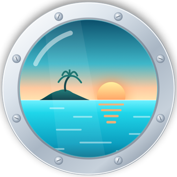

# Porthole

**Windows PC games on your iPhone and iPad.**<br>
Bring your own games or download the ones you own on Steam, Epic Games, GOG and itch.io, play with touch or a controller, and see how every game runs before you try it.

<a href="https://portholehq.site"></a>
<a href="#install"></a>
<a href="https://portholehq.site/compat.html"></a>
<a href="https://discord.gg/N7PkdptTFn"></a>

<br>

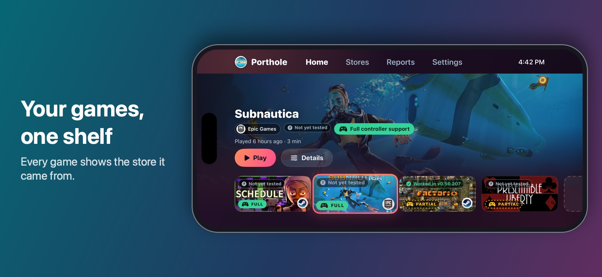

</div>

> **Status: early.** Porthole is a hobby project made and tested by one person on a few devices. This repository holds the source code and the guides;
> the first release is on the [Releases page](https://github.com/tylerkaska112/PortHole/releases).

## What makes Porthole different

These are the things Porthole was built around. Other projects may offer some of them; this is the list of what you get here.

- **A console-style home screen.** Your games sit on one shelf. Move along it with a controller and the chosen game grows, with its name,
  badges and Play right there. The whole app can be used without touching the screen.
- **Controller support, shown on every game.** Porthole reads Steam's own list and marks each game **FULL** or **PARTIAL**. Press the badge and it
  explains what that means and how to cover the parts a controller cannot reach.
- **Compatibility you can trust.** Every game shows a badge from real reports by real people on real devices, counted per device model and per
  version of the game engine, so a badge from an older engine is never passed off as a result for the current one. A game nobody has tried
  says so plainly: **Not yet tested**.
- **What works for others.** Porthole can show the settings people used when a game ran well, and apply them in a tap.
- **Shared key binds.** Share and download controller and touch layouts for a game, reviewed before they appear.
- **One Stores tab for every launcher.** Steam, Epic Games, GOG and itch.io each have a library of their own, laid out the same way: a grid of your
  games and a page for every game. One Downloads page shows what all four are downloading, with Pause, Resume and "Download now", and one more
  page shows all of your games together. Every game carries the logo of the store it came from, on its card and on the home screen.
- **A Steam client built in.** Sign in (password and Steam Guard, or a QR code), download the games you own, resume interrupted downloads, and start
  them through Steam itself so your licence is checked the normal way. Steam Cloud files are fetched before a game starts.
- **Epic Games too.** Sign in on Epic's own page, install the games your account owns that have a Windows version straight from Epic's servers, and
  play them without Epic's launcher. Epic's overlay and anti-cheat are not supported, so some games will not run.
- **GOG and itch.io too.** GOG: sign in on GOG's own page and the games you own that have a Windows build are downloaded straight from GOG's
  servers (older titles that only have a setup file use that instead). itch.io: sign in with a personal API key you make there, and the games you
  bought, claimed or put in a collection (free ones included) that have a Windows download are fetched, unpacked and added to your library.
- **Downloads that keep going.** The queue keeps downloading when you leave the app, and a card on the lock screen and in the Dynamic Island shows the
  percentage, size, speed and time left, with Pause, Resume and Cancel buttons. Downloads fetch many pieces at once and resume after an interruption.
- **No computer needed to switch JIT on.** On iOS 27 or later, Porthole can make its own pairing file on the device. On earlier versions you do it once.
- **Updates on your own terms.** Update from inside the app with your own certificate, go back to an older version if something broke, or just
  download any version as a file. While it updates, Porthole shows each step and the progress and tells you to stay in the app. A build that carries
  its maintainer's release key installs only updates that are signed with the matching private key.
- **A menu made for playing.** Slide in from the screen's edge (or hold Menu + View on a controller) for a side panel with Performance, Controls and
  Game tabs: power mode, frame generation, the controller the game sees, on-screen controls, and an optional performance overlay you choose the numbers for.
- **Short guides that explain themselves.** Each screen explains itself the first time you open it, a first-game tour shows how to play, and a
  question mark brings any guide back. Tips can be turned off in Settings.
- **Considerate with your VPN.** If you have a VPN on, Porthole asks before pausing it for a moment, and can turn it back on afterwards.
- **Your saves are looked after.** Automatic save backups, and a restore when you need one.
- **Honest about what it needs.** Windows components come straight from Microsoft and are checked against a fixed fingerprint. Porthole bundles
  no games and no ads, and asks for no account.
- **Free software.** GPL-3.0-or-later, with the credits for everything it is built on.

## Built by the community, for the community

Porthole only knows how a game runs because **people tell it**. The compatibility list, the badges on every game and the shared key binds
are all made of reports and layouts sent in by the people who use the app. There is no lab and no test farm behind it.

- **A report takes under a minute.** After you play, Porthole asks how it went. You choose how it ran, whether it crashed and which store
  the files came from, and you can add a short note. Nothing in it names you, and you see exactly what is sent.
- **Early on, most games will say "Not yet tested".** That is not a verdict. It means nobody has reported that game yet, and your report
  could be the first one.
- **The more people report, the more useful it gets for everyone,** including on your own model of phone.

See the [compatibility list](https://portholehq.site/compat.html) and the [privacy page](https://portholehq.site/privacy.html).

## What is Porthole?

Porthole is an iOS app that runs Windows games. It is the app around the [Madeira](https://github.com/willfaust/Madeira) runtime (Wine,
FEX-Emu and DXMT): a game library, store clients for Steam, Epic Games, GOG and itch.io, a simple setup guide, and an optional community list that says
which games work on which phones.

## Highlights

| | |
|---|---|
| **A shelf that feels like a console** | Your games on one row. Move along it and the chosen game grows, with its name, badges and Play. |
| **Made for a controller** | Use the whole app with a game controller. Steam says which games support one, and Porthole shows it as a FULL or PARTIAL badge. |
| **Your games your way** | Copy a game folder in from Files, run a Windows installer, or sign in to Steam, Epic Games, GOG or itch.io and download the games you own. |
| **Every store in one tab** | Steam, Epic Games, GOG, itch.io and all games together, each with its logo, one Downloads page and a page for every game. |
| **Know before you try** | Badges from reports by other people: works great, works with problems, or doesn't work. Add your own in under a minute. |
| **Simple setup** | Three steps: full speed (JIT and a private link), Microsoft's Windows components, and your games. |
| **Private by design** | No ads, no account, no tracking. A report is only sent when you choose to send one. |

## Screenshots

<p align="center">
  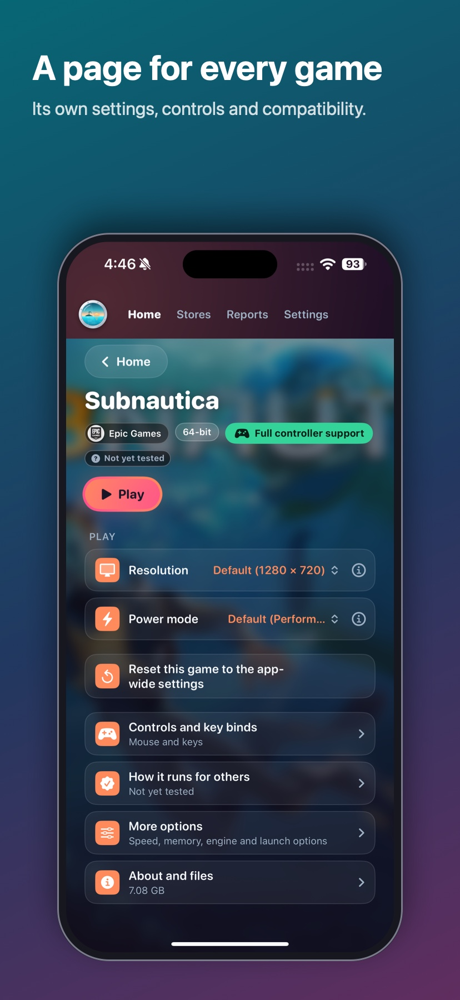
  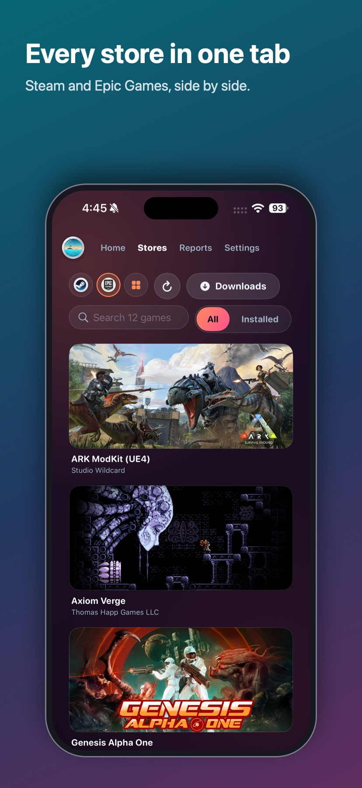
  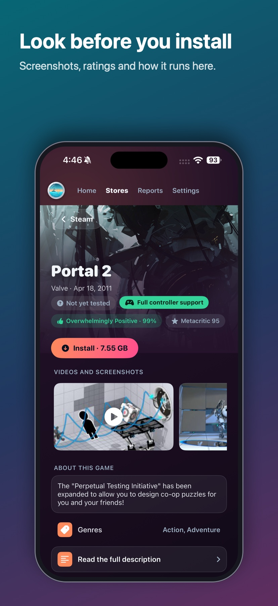
  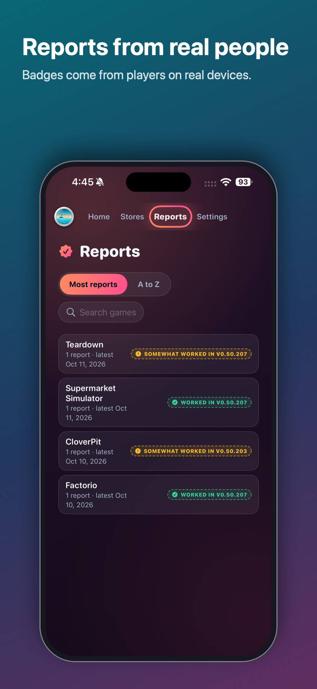
  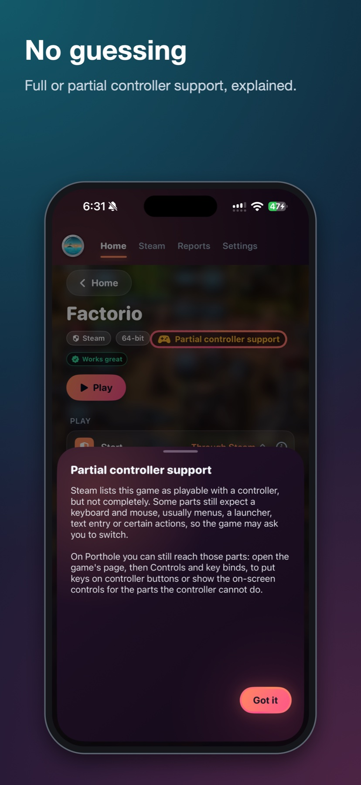
</p>
<p align="center">
  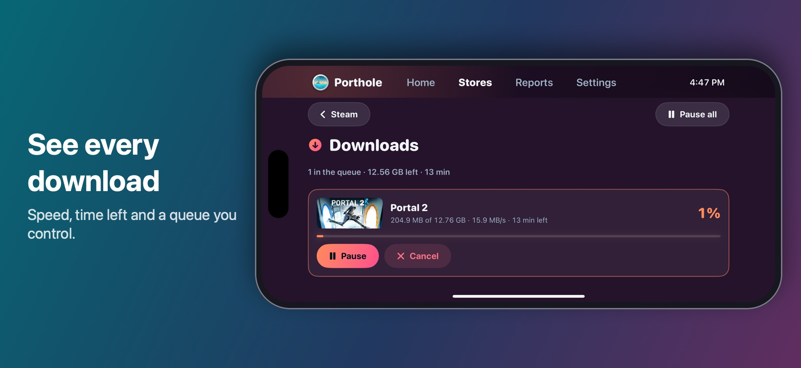
  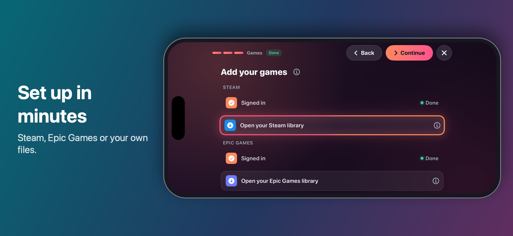
</p>
<p align="center">
  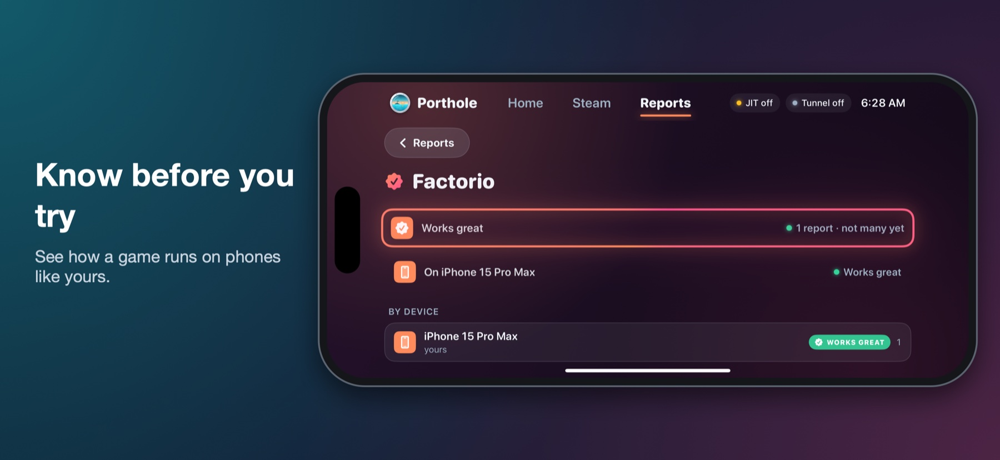
  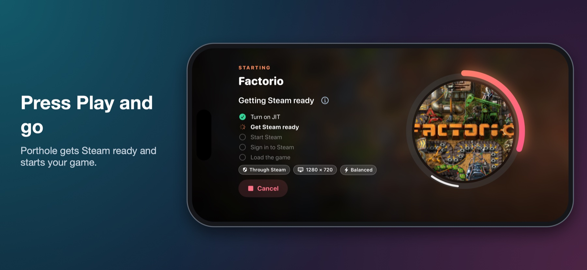
</p>
<p align="center"><sub>Screenshots from an iPhone 15 Pro Max, with a drawn phone around them. Game artwork belongs to its owners.</sub></p>

## What to expect

- **It is early.** Plenty of games do not run yet, and some that do need tweaking. The [compatibility list](https://portholehq.site/compat.html) shows what people have tried.
- **It takes some setting up.** Porthole is not on the App Store and cannot be: it uses interfaces Apple keeps private. You sign it with your own developer certificate and install it yourself.
- **You bring the games.** Porthole contains no games and does not get around any copy protection. You need to own what you run.

## What you need

- An iPhone or iPad with **iOS 18 or later**. More memory is better: a game that needs more than the device has cannot run.
- A way to **sign and install an app yourself**, with a development certificate and provisioning profile that include *Network Extension (packet tunnel)*,
  *Personal VPN*, *Increased Memory Limit*, *Extended Virtual Addressing* and *get-task-allow*. A **paid Apple Developer account** or a **third-party
  certificate service** can provide all of them (recommended); a **free Apple ID** works for the core of the app with some of them missing (see below).
- JIT switched on for the app. Porthole can do it by itself once it has a pairing file; on iOS 27 or later it can make that file on the device.

## Signing certificates: what to use

Porthole is not on the App Store, so it has to be signed before iOS will run it. The certificate and profile you sign with decide whether it
works well, so this is worth getting right.

**Recommended: your own *development* certificate and profile from a paid Apple Developer account.** That gives you:

- **JIT.** The profile has to include **get-task-allow**, which is what lets Porthole switch JIT on (it attaches a debugger to itself).
  Only a *development* profile carries it; ad-hoc and App Store profiles do not.
- **The capabilities Porthole needs:** *Network Extension (packet tunnel)* and *Personal VPN* for its private link, and *Increased Memory Limit*
  and *Extended Virtual Addressing* so games get as much memory as the device can give.
- **Signing without limits that get in the way.** Porthole and its three optional extensions are up to four app ids, and Porthole can sign every new version
  of itself on your device when you give it your certificate (`.p12`) and profile. A paid account does not expire after a week and does not run
  into the small weekly app id and app count limits of a free one, so updating, reinstalling and trying a build stay painless.

**Short on App IDs?** The same IPA can be installed without any of its extensions: without the download card (one App ID less, downloads then show
iOS's own progress card), without the tunnel (LocalDevVPN provides the private link) or without the tunnel and the JIT helper (StikDebug or another
tool switches JIT on). The lightest install is one App ID. Porthole checks what is inside your install and which permissions your signature carries
(Settings, Stores and JIT, Your install) and tells you what is missing. See [docs/INSTALL.md](docs/INSTALL.md#fewer-app-ids-optional).

**What to check on a certificate and profile before relying on it**
1. It is a **development** certificate and the profile lists **your device**.
2. The profile includes **get-task-allow** and the four capabilities above, for the app and for each extension.
3. You hold the **`.p12` and its password**, so Porthole can sign its own updates. Without them you can still download new versions as a
   file and sign them yourself.

**A free Apple ID works, with limits.** It can run the core of the app (library, stores, downloads, games), but it cannot add the Network Extension,
Personal VPN and memory capabilities, so there is no built-in private link (use LocalDevVPN for it) and memory-hungry games are more likely to run out of
memory, and its profiles expire after about seven days. Porthole checks what your signature really carries and tells you what is missing and what it costs
(Settings, Stores and JIT, Your install).

**Be careful with signing you do not control.** A third-party certificate can be revoked without warning, and whoever signs the app is trusted with
what it holds: your store sign-ins and your games. Choose a service you trust.

Apple changes account limits from time to time; check Apple's current developer documentation for the exact numbers.

<a id="install"></a>
## Install

### Option 1: a release
1. Download `Porthole-<version>-<build>.ipa` and its `.sha256` file from the [Releases page](https://github.com/tylerkaska112/PortHole/releases) and check the checksum:
   ```bash
   shasum -a 256 -c Porthole-*.ipa.sha256
   ```
2. Sign the app and its three extensions with your certificate and profiles, keeping the bundle ids in step (`your.id`, `your.id.jithelper`, `your.id.tunnel`, `your.id.activity`), and install it.
3. Open Porthole and follow the setup guide.

### Option 2: build it from the source code
This is how the project is built.

**You need:** a Mac with a current Xcode (iOS 18 SDK or later), [XcodeGen](https://github.com/yonaskolb/XcodeGen), and the signing setup above.

1. **Get the source** and its pinned submodule:
   ```bash
   git clone --recurse-submodules https://github.com/tylerkaska112/PortHole.git
   cd PortHole
   ```
2. **Build the runtime.** The Madeira runtime (Wine, FEX-Emu, DXMT) is a submodule pinned to the commit it was built from, with a set of patches on top.
   Follow `docs/SOURCE.md` (versions and patches) and `docs/REBUILD.md` (what is rebuilt and in which order); both are published with the source. Then stage it for the app:
   ```bash
   tools/stage_runtime.sh
   ```
3. **Set your identity.** Copy the example file and put in your own bundle id (and, optionally, your own server addresses):
   ```bash
   cp app/Config/Local.xcconfig.example app/Config/Local.xcconfig
   ```
4. **Generate the Xcode project and build an unsigned app:**
   ```bash
   cd app && xcodegen generate && cd ..
   xcodebuild -project app/Porthole.xcodeproj -scheme Porthole -configuration Debug \
     -destination 'generic/platform=iOS' -derivedDataPath build/DD CODE_SIGNING_ALLOWED=NO build
   tools/package_app.sh build/DD/Build/Products/Debug-iphoneos/Porthole.app Porthole.ipa
   ```
5. **Sign and install** `Porthole.ipa` with your certificate and profiles, as in option 1, then follow the setup guide on the device.

**Check your work** without a device: `cd Packages/LauncherCore && swift test` runs the signer, update catalog and transport tests.
A full guide, with the details of each part, is in [`docs/INSTALL.md`](docs/INSTALL.md). The build sequence has not yet been repeated on a clean machine from
scratch; if a step is wrong, that is a bug in the guide, so please open an issue.

## Community

Questions, help with setup, or just want to talk about games? **[Join the Discord](https://discord.gg/N7PkdptTFn)**. Support questions have their own ticket-style
channels, and there are general and off-topic channels for everything else. Bugs and feature ideas also belong on the
[issue tracker](https://github.com/tylerkaska112/PortHole/issues/new/choose).

## Built with AI

Porthole was built with the help of AI. A large part of the code, the documentation, the website and the artwork was written by an AI coding
assistant (Claude, from Anthropic) working with the maintainer, who directs the project, reviews the changes and tests them on real devices.
The code in this project therefore contains AI-written code, and, like any software, it may contain mistakes. If you find one, please open an issue.

## Privacy

No ads, no analytics, no account. A compatibility report is sent only when you tap Send, and it contains your device model, iOS version
and your answers, nothing that names you. A problem report is a file you can share wherever you like; it goes to the project's server only if you choose
"Send it to Porthole's server", it stays private, and you can read exactly what it contains first. [Read the privacy page](https://portholehq.site/privacy.html) for exactly what leaves your device.

## Licence

Porthole is free software under the **GNU General Public License, version 3 or (at your option) any later version**. See [`LICENSE`](LICENSE).
An additional permission for Apple's Metal Shader Converter is in [`LICENSE-EXCEPTION.md`](LICENSE-EXCEPTION.md). The projects Porthole is built on
keep their own licences; see [`CREDITS.md`](CREDITS.md).

## With thanks

[Madeira](https://github.com/willfaust/Madeira), [Iridium](https://github.com/intraducine/iridium), [StikDebug](https://github.com/StikDebug/StikDebug),
[idevice](https://github.com/jkcoxson/idevice), [StikPair](https://github.com/StikDebug/StikPair), and the other projects listed in [`CREDITS.md`](CREDITS.md).

## Unofficial

Porthole is not affiliated with or endorsed by Valve, Steam, Microsoft, Apple, Epic, GOG or any game publisher. It does not bypass any licence
check or copy protection: Steam games are started through Valve's own Steam client files, which check your licence exactly as they do on a PC,
and Epic games are installed from Epic's own servers with your own Epic account.
Game, store and company names belong to their owners. Apple, iPhone, iPad and iOS are trademarks of Apple Inc.
